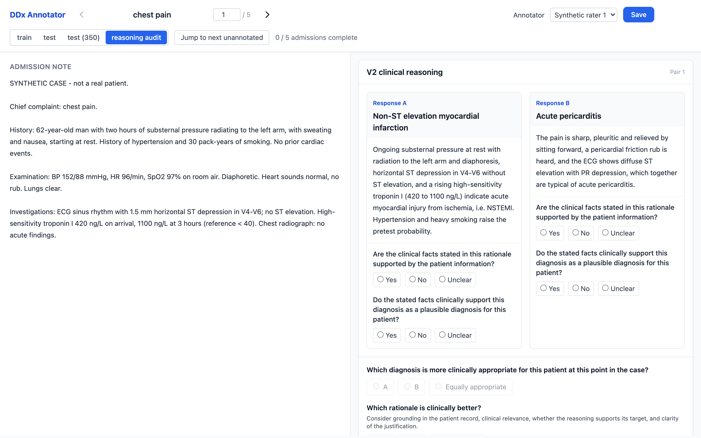

# MERLIN-DDx Annotator

Clinical annotation interface, evaluation protocol, rubric, and reproducibility tools for the MERLIN-DDx clinician evaluation study.

This repository accompanies the MERLIN-DDx paper. MERLIN-DDx generates diagnostic reasoning traces in stages and keeps a stage's rationale only when external verifiers accept it. To check whether verifier-accepted rationales are better than zero-shot rationales in the eyes of clinicians, two clinicians rated, blinded to condition, the diagnosis-stage (V2) and ICD-coding-stage (V4) rationales of 42 admissions (paper, Appendix B). This repository contains everything about that evaluation that can be public:

| If you want to | Start here |
|---|---|
| **Understand** how the evaluation was run | [Protocol](docs/protocol.md) · [Rubric](docs/rubric.md) · [Walkthrough with screenshots](docs/annotation_walkthrough.md) · [Results](results/README.md) |
| **Explore** the interface and the analysis | [Quick start](#quick-start-synthetic-cases): runs on synthetic cases, no credentials needed |
| **Reproduce** the published numbers | [Reproducibility guide](docs/reproducibility.md) · [Data access](docs/data_access.md) |



*The study interface on a synthetic case: the admission note (left) and the blinded diagnosis-stage pair with the rubric questions (right). All content shown is synthetic.*

## The clinician evaluation



- **Cases:** 42 admissions, six for each of seven chief complaints. Each admission has one V2 pair (diagnosis) and one V4 pair (ICD code): 84 pairs, 168 rationales.
- **Conditions:** a rationale from the MERLIN-DDx generator–verifier loop (Qwen3-32B) and a zero-shot rationale, shown side by side as Response A and Response B. Which was which, the verifier score and the loop outcome were kept in a separate allocation key that never reached the rating server.
- **Rubric:** for each response, *Q1: Are the clinical facts stated in this rationale supported by the patient information?* and *Q2: Do the stated facts clinically support this diagnosis / this specific ICD diagnosis?* (Yes / No / Unclear). For each pair, which target is more appropriate (only when the targets differ) and which rationale is clinically better. The exact wording is in [docs/rubric.md](docs/rubric.md); the machine-readable version, [config/rubric.json](config/rubric.json), is tested against the interface and the server.
- **Primary outcome:** a rationale is *valid* when Q1 = Yes and Q2 = Yes; the contrast is loop minus zero-shot validity within admission, with admission-cluster bootstrap intervals.

The [protocol](docs/protocol.md) marks, element by element, what was fixed before rating and what was documented afterwards, and lists the open discrepancies with the paper.

## Quick start (synthetic cases)

Requirements: Python 3.11+, Node.js 22. No PhysioNet credentials, external services, cluster or GPU.

```bash
git clone https://github.com/DATEXIS/merlin-ddx-annotator.git && cd merlin-ddx-annotator
uv sync --extra analysis --extra dev            # or: python -m pip install -e ".[analysis,dev]"
npm ci && npm run build
uv run python scripts/run_demo.py               # open http://127.0.0.1:8765
```

Pick *Synthetic rater 1* in the annotator menu and rate the five synthetic admissions. Answers are saved by the study backend to `.demo/data_root/rebuttal_audit_annotations/` (git-ignored); `--with-ratings` preloads the synthetic raters' answers and `--reset` starts over. Then:

```bash
uv run python scripts/demo_summary.py --ratings .demo/data_root/rebuttal_audit_annotations   # aggregate your ratings
uv run python scripts/make_synthetic_analysis_fixture.py --out .demo/fixture                  # full-size synthetic study
uv run python scripts/run_original_analysis.py --blinded .demo/fixture/audit_batch1_blinded.csv \
  --keyed .demo/fixture/audit_batch1_keyed.csv --rater r1=.demo/fixture/exports/synthetic_rater_1 \
  --rater r2=.demo/fixture/exports/synthetic_rater_2 --out .demo/run                           # the original analysis
```

The [walkthrough](docs/annotation_walkthrough.md) shows each step of a rating with screenshots, and [examples/synthetic/](examples/synthetic/README.md) describes what each synthetic case demonstrates.

## Published results

| Stage | Valid, loop | Valid, zero-shot | Loop minus zero-shot (pp, 95% CI) | Agreement on validity (p_o, Cohen's κ) |
|---|---|---|---|---|
| V2 diagnosis | 91.7% | 92.9% | −1.2 [−8.3, 7.1] | 0.869, 0.105 |
| V4 ICD coding | 65.5% | 66.7% | −1.2 [−16.7, 14.3] | 0.726, 0.389 |

Rates pool both clinicians (84 judgments per stage and arm). Validity did not differ detectably between loop and zero-shot rationales at either stage (both intervals include zero); the diagnosis-stage κ is low because validity is near ceiling. All cohort-level results, including Q1 and Q2 rates, preferences, the verifier-score association and the rater contingency matrices, are in [results/](results/README.md), with a record of which manuscript statements they reproduce.

## Reproducing the results

- **From this repository alone:** every Cohen's κ published with a full contingency matrix, including the paper's coding-stage 0.73 / κ 0.39 (`python scripts/kappa_from_contingency.py`).
- **With the credentialed PhysioNet data:** every pooled rate, difference and preference margin with its bootstrap interval, and raw agreement, exactly (`python scripts/reproduce_from_credentialed.py`). Per-item aggregates do not identify which clinician gave which rating, so they do not reproduce κ; κ comes from the public matrices. The PhysioNet release also contains the exact annotation inputs, so credentialed users can review or re-rate the 42 cases in this interface.
- **Not possible from released data:** per-clinician analyses (published as the ranges the paper reports) and independent reproduction of κ for the three measures whose matrices are released in reduced form; they need the individual clinician ratings, which are not distributed.

Details, commands and the full statistic-by-data table: [docs/reproducibility.md](docs/reproducibility.md).

## Data access

This repository contains **no patient data**: all cases, rationales and ratings here are synthetic. The evaluated rationale texts derive from MIMIC-IV notes; they and the per-item aggregate ratings are part of the credentialed MERLIN-DDx datasets on PhysioNet, available to credentialed users who sign the PhysioNet data use agreement. The MIT licence of this software grants no rights to PhysioNet data. See [docs/data_access.md](docs/data_access.md).

## Repository layout

| Path | Content |
|---|---|
| `src/` | React interface; `src/components/RebuttalAudit.tsx` is the study's audit screen, unchanged |
| `merlin_ddx/` | Study backend (`sync_api.py`, `rebuttal_audit.py`, `annotation_store.py`) and the original analysis (`rebuttal_analysis.py` and companions) |
| `scripts/` | Demo, original analysis entry points, reproduction tools |
| `config/rubric.json` | Machine-readable rubric |
| `docs/` | Protocol, rubric, walkthrough, reproducibility, data access, figures |
| `results/` | Published cohort-level results and agreement statistics |
| `examples/synthetic/` | Synthetic cases, allocation key, ratings and expected outputs |
| `tests/` | Synthetic-only Python, frontend and end-to-end tests |

How this release differs from the code that ran the study is listed in [CHANGES_FROM_STUDY.md](CHANGES_FROM_STUDY.md).

## Tests

```bash
uv run pytest                       # backend, rubric consistency, original analysis, reproduction (synthetic only)
npx vitest run                      # interface components
PYTHON=.venv/bin/python npx playwright test   # end-to-end on the demo server (after npm run build)
```

## Citation, licence, acknowledgments

If you use this software or the evaluation materials, please cite it using [CITATION.cff](CITATION.cff), together with the MERLIN-DDx paper; the paper reference will be added to CITATION.cff once the camera-ready version is published. The software is released under the [MIT licence](LICENSE); third-party material is listed in [THIRD_PARTY_NOTICES.md](THIRD_PARTY_NOTICES.md). We thank the clinicians who rated the rationales. MIMIC-IV is provided by PhysioNet under its credentialed data use agreement.
