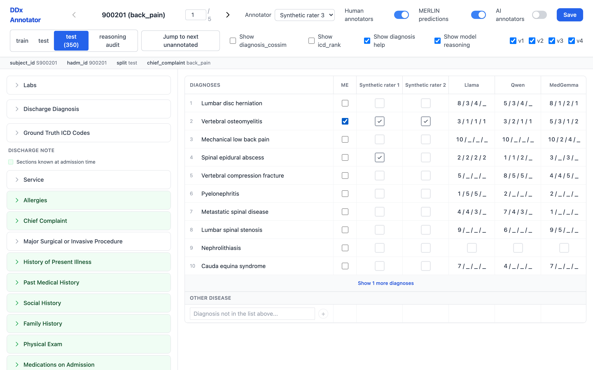

# MERLIN-DDx Annotator

Clinical annotation interface, protocols, analysis code, cohort-level results and reproducibility tools for the clinician studies of the MERLIN-DDx paper.

MERLIN-DDx generates diagnostic reasoning traces in stages and keeps a stage's rationale only when external verifiers accept it. Its reference targets come from mapping each admission to a WikiDoc differential diagnosis. Clinicians checked both: the targets and the rationales. This repository contains the interface they used and everything about their studies that can be public:

| Activity | What clinicians did | In the paper | Documentation |
|---|---|---|---|
| **DDx annotation, 70-case pilot** | Confirmed the correct diagnosis of 70 admissions against the WikiDoc candidate list (one clinician) | Not reported | [docs/ddx_annotation/](docs/ddx_annotation/README.md) |
| **DDx annotation, 350-case study** | The same for 350 stratified test admissions; three clinicians, 316 cases double-annotated | §6.5, Appendix A.2 | [docs/ddx_annotation/](docs/ddx_annotation/README.md) |
| **Reasoning audit, 42 admissions** | Rated loop vs zero-shot rationales, blinded to condition (two clinicians) | §6.5, Appendix B | [docs/reasoning_audit/](docs/reasoning_audit/README.md) |

A fourth design in the code, a 70-case *verification* view, collected no judgments and is documented only as superseded ([docs/verification/](docs/verification/README.md)).

| If you want to | Start here |
|---|---|
| **Understand** how the studies were run | DDx: [protocol](docs/ddx_annotation/protocol.md) · [walkthrough](docs/ddx_annotation/annotation_walkthrough.md) · [analysis](docs/ddx_annotation/analysis.md) — Audit: [protocol](docs/protocol.md) · [rubric](docs/rubric.md) · [walkthrough](docs/annotation_walkthrough.md) |
| **See the results** | [DDx results](results/ddx_annotation/README.md) · [audit results](results/README.md) |
| **Explore** the interface and the analysis | [Quick start](#quick-start-synthetic-cases): runs on synthetic cases, no credentials needed |
| **Reproduce** the published numbers | [Reproducibility guide](docs/reproducibility.md) · [Data access](docs/data_access.md) |



*The study interface on a synthetic case of the 350-case view. All content shown is synthetic.*

## The DDx annotation (pilot and 350-case study)



- **Task:** for each admission, confirm the clinically correct diagnosis.
  - The clinician checks one or more candidates from the WikiDoc list of the chief complaint (19 to 74 diseases, ranked by cosine similarity to the discharge-diagnosis text).
  - A diagnosis missing from the list is added in an *Other Disease* row.
- **Cases:**
  - Pilot: 70 admissions, 10 per chief complaint, 35 train / 35 test.
  - Study: 350 test admissions, 50 per chief complaint, disease-balanced draw without pilot cases.
- **Information shown:**
  - The full discharge summary with labs, the discharge diagnosis and the coder ICD codes. This is intended, because the task is retrospective reference annotation.
  - Clinicians were instructed to hide the MERLIN model predictions and the other clinicians' marks.
  - The interface shows both by default and can hide them, but it does not enforce hiding and keeps no interaction log. Instruction, interface behaviour and the lack of logs are documented separately in the [protocol](docs/ddx_annotation/protocol.md).
- **Analysis:** candidate-level selections, with unchecked candidates counted as not selected (the original rule). The analysis compares them with two automated references (ICD-derived, cosine), between clinicians (Cohen's and Fleiss' κ, exact-set agreement, Jaccard, nesting) and, as a secondary analysis, with the model rankings. There is no consensus step.

| 350-case study (final records) | Value |
|---|---|
| Clinician 1 agrees with the ICD-derived / cosine reference | 77.1% [72.6, 81.4] / 68.0% [63.1, 72.6] of 350 cases |
| Confirmed diagnosis missing from the candidate list | 11.4% (recall ceiling 0.886) |
| Cohen's κ, Clinicians 1 and 2 | 0.913 on 236 cases; exact-set agreement 89.0%, mean Jaccard 0.912 |
| Clinician 3 (121 cases) | κ 0.740 with Clinician 1; selection contained in Clinician 1's in 97 cases (80.2%) |
| Fleiss' κ, all three clinicians | 0.811 on 41 cases |

All DDx results, including the pilot: [results/ddx_annotation/](results/ddx_annotation/README.md).

## The clinician evaluation

The reasoning audit (unchanged since v1.0.0):


*The audit screen on a synthetic case: the admission note (left) and the blinded diagnosis-stage pair with the rubric questions (right). All content shown is synthetic.*


- **Cases:** 42 admissions, six for each of seven chief complaints. Each admission has one V2 pair (diagnosis) and one V4 pair (ICD code): 84 pairs, 168 rationales.
- **Conditions:** a rationale from the MERLIN-DDx generator–verifier loop (Qwen3-32B) and a zero-shot rationale, shown side by side as Response A and Response B. Which was which, the verifier score and the loop outcome were kept in a separate allocation key that never reached the rating server.
- **Rubric:** for each response, two questions, each answered Yes / No / Unclear:
  - *Q1: Are the clinical facts stated in this rationale supported by the patient information?*
  - *Q2: Do the stated facts clinically support this diagnosis / this specific ICD diagnosis?*

  For each pair, the clinician also says which target is more appropriate (only when the targets differ) and which rationale is clinically better. The exact wording is in [docs/rubric.md](docs/rubric.md); the machine-readable version, [config/rubric.json](config/rubric.json), is tested against the interface and the server.
- **Primary outcome:** a rationale is *valid* when Q1 = Yes and Q2 = Yes; the contrast is loop minus zero-shot validity within admission, with admission-cluster bootstrap intervals.

The [protocol](docs/protocol.md) marks, element by element, what was fixed before rating and what was documented afterwards, and lists the open discrepancies with the paper.

## Create your own reasoning annotation study

The new local workflow supports V1–V4 paired evaluation from raw MERLIN generation tables or explicit JSONL trace sources, with stage-specific questions, deterministic A/B allocation, trace-linked aggregate rating export, and analysis without the original study-size constraint. See [the study-building guide](docs/build_annotation_cases.md) for commands, data formats, and limitations. The new questions are proposed rubrics and are separate from the historical clinician studies.

## Quick start (synthetic cases)

Requirements: Python 3.11+, Node.js 22. No PhysioNet credentials, external services, cluster or GPU.

```bash
git clone https://github.com/DATEXIS/merlin-ddx-annotator.git && cd merlin-ddx-annotator
uv sync --extra analysis --extra dev            # or: python -m pip install -e ".[analysis,dev]"
npm ci && npm run build
uv run python scripts/run_demo.py --with-ratings    # open http://127.0.0.1:8765
```

- **DDx annotation:** the application opens on the pilot *train* view.
  1. Choose *test (350)* and *Synthetic rater 3*.
  2. Check diagnoses, add a missing one under *Other Disease*, and save.
  3. Switch off *Human annotators* and *MERLIN predictions* to annotate as clinicians were instructed to.
- **Reasoning audit:** choose *reasoning audit* and *Synthetic rater 1*.
- **Storage:** everything is saved by the study backend under `.demo/data_root/` (git-ignored). `--reset` starts over; without `--with-ratings` no synthetic ratings are preloaded.

```bash
# DDx: the original analysis on the synthetic cases
uv run python scripts/make_synthetic_ddx_fixture.py --out .demo/ddx_fixture
uv run python scripts/run_ddx_analysis.py study --fixture .demo/ddx_fixture --out .demo/ddx_study
uv run python scripts/ddx_agreement.py --fixture .demo/ddx_fixture --out .demo/ddx_study/agreement.json

# Audit: aggregate your ratings; the original analysis on a full-size synthetic study
uv run python scripts/demo_summary.py --ratings .demo/data_root/rebuttal_audit_annotations
uv run python scripts/make_synthetic_analysis_fixture.py --out .demo/fixture
uv run python scripts/run_original_analysis.py --blinded .demo/fixture/audit_batch1_blinded.csv \
  --keyed .demo/fixture/audit_batch1_keyed.csv --rater r1=.demo/fixture/exports/synthetic_rater_1 \
  --rater r2=.demo/fixture/exports/synthetic_rater_2 --out .demo/run
```

The walkthroughs show each step with screenshots: [DDx](docs/ddx_annotation/annotation_walkthrough.md) · [audit](docs/annotation_walkthrough.md). What each synthetic case demonstrates is described in [examples/synthetic/](examples/synthetic/README.md).

## Published results

**DDx annotation:** the table above and [results/ddx_annotation/](results/ddx_annotation/README.md). That folder has coverage, selections, reference agreement, inter-rater agreement with contingency matrices, and secondary model-evaluation tables, all cohort-level.

**Reasoning audit:**

| Stage | Valid, loop | Valid, zero-shot | Loop minus zero-shot (pp, 95% CI) | Agreement on validity (p_o, Cohen's κ) |
|---|---|---|---|---|
| V2 diagnosis | 91.7% | 92.9% | −1.2 [−8.3, 7.1] | 0.869, 0.105 |
| V4 ICD coding | 65.5% | 66.7% | −1.2 [−16.7, 14.3] | 0.726, 0.389 |

- **Pooling:** rates pool both clinicians (84 judgments per stage and arm).
- **Finding:** validity did not differ detectably between loop and zero-shot rationales at either stage; both intervals include zero.
- **Diagnosis-stage κ:** low because validity is near ceiling.

All audit results are in [results/](results/README.md), with a record of which manuscript statements they reproduce. They include Q1 and Q2 rates, preferences, the verifier-score association and the rater contingency matrices.

## Reproducing the results

**From this repository alone:**

- every κ published with a full contingency matrix: the DDx inter-rater κ (`python scripts/ddx_kappa_from_contingency.py`) and the audit's, including the paper's coding-stage 0.73 / κ 0.39 (`python scripts/kappa_from_contingency.py`);
- the complete analysis pipelines, on synthetic data.

**With the credentialed PhysioNet data (audit):**

- **Reproducible:** every pooled rate, difference and preference margin with its bootstrap interval, and raw agreement, exactly (`python scripts/reproduce_from_credentialed.py`).
- **Not κ:** per-item aggregates do not identify which clinician gave which rating, so they do not reproduce κ; κ comes from the public matrices.
- **Annotation inputs:** the PhysioNet release also contains the exact inputs, so credentialed users can review or re-rate the 42 cases in this interface.

**Not possible from released data:**

- **Per-clinician analyses** need the individual clinician annotations, which are not distributed. This covers the DDx reference agreement and set statistics, and the audit's per-clinician ranges and three reduced-matrix κ values.
- **The study team** reproduced these from the internal records with the code here.

Details, commands and the full statistic-by-data table: [docs/reproducibility.md](docs/reproducibility.md).

## Data access

This repository contains **no patient data**: all cases, notes, rationales, predictions and annotations here are synthetic.

- **PhysioNet:** the study inputs derive from MIMIC-IV and are released only through the credentialed MERLIN-DDx release on PhysioNet, for credentialed users who sign the data use agreement. That release is not yet published.
- **Internal:** individual clinician annotations and identities stay internal.
- **Licence:** the MIT licence of this software grants no rights to PhysioNet data.

See [docs/data_access.md](docs/data_access.md).

## Repository layout

| Path | Content |
|---|---|
| `src/` | The study's React application, unchanged: `App.tsx` (DDx views and view switching), `components/DiagnosesPanel.tsx` (DDx annotation), `components/RebuttalAudit.tsx` (audit screen). `main.tsx` adds a fallback to the audit-only shell `AuditApp.tsx` for data roots without DDx cases |
| `merlin_ddx/` | Study backend (`sync_api.py`, `annotation_store.py`, `rebuttal_audit.py`) and the original audit analysis (`rebuttal_analysis.py` and companions) |
| `scripts/` | DDx analysis (`analyse_annotations.py`, `analyse_scaleup_annotations.py`, `sample_blind_annotation.py`, sanitized study code; `run_ddx_analysis.py`, `ddx_agreement.py`), audit analysis entry points, demo and reproduction tools |
| `docs/` | `ddx_annotation/`, `reasoning_audit/`, `verification/`; audit protocol, rubric, walkthrough; reproducibility, data access, figures |
| `results/` | Published cohort-level results: audit (top level) and `ddx_annotation/` |
| `examples/synthetic/` | Synthetic cases, annotations, ratings and expected outputs for both activities |
| `tests/` | Synthetic-only Python, frontend and end-to-end tests |

How this release differs from the code that ran the studies is listed in [CHANGES_FROM_STUDY.md](CHANGES_FROM_STUDY.md).

## Tests

```bash
uv run pytest                       # backend, both analyses, rubric, reproduction, synthetic data (synthetic only)
npx vitest run                      # application shell and audit screen
PYTHON=.venv/bin/python npx playwright test   # end-to-end on the demo server (after npm run build)
```

## Citation, licence, acknowledgments

If you use this software or the evaluation materials, please cite it using [CITATION.cff](CITATION.cff), together with the MERLIN-DDx paper. The paper reference will be added to CITATION.cff once the camera-ready version is published.

The software is released under the [MIT licence](LICENSE); third-party material is listed in [THIRD_PARTY_NOTICES.md](THIRD_PARTY_NOTICES.md).

We thank the clinicians who annotated the cases and rated the rationales. MIMIC-IV is provided by PhysioNet under its credentialed data use agreement.
