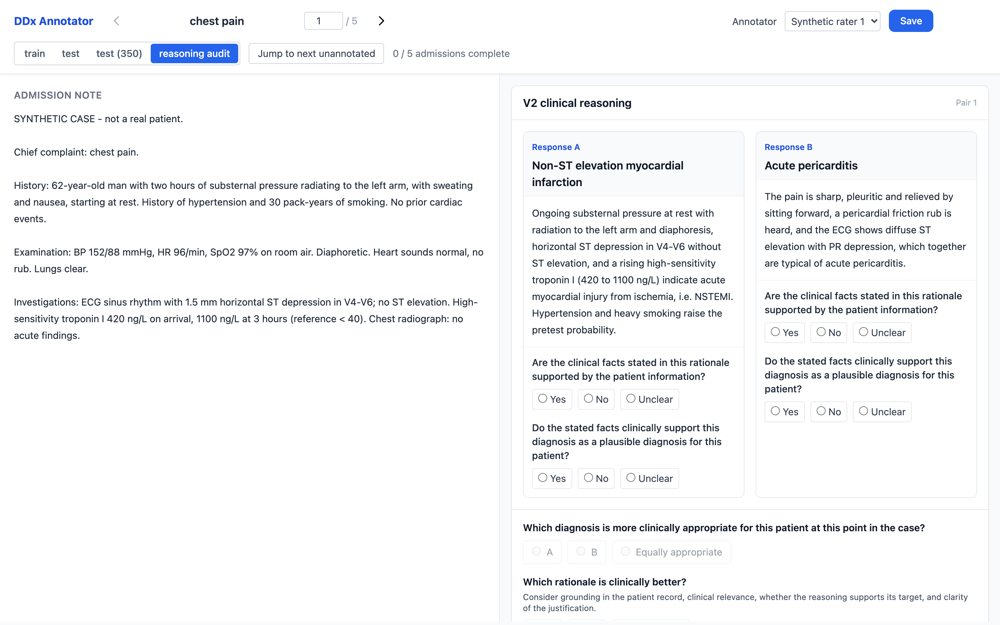
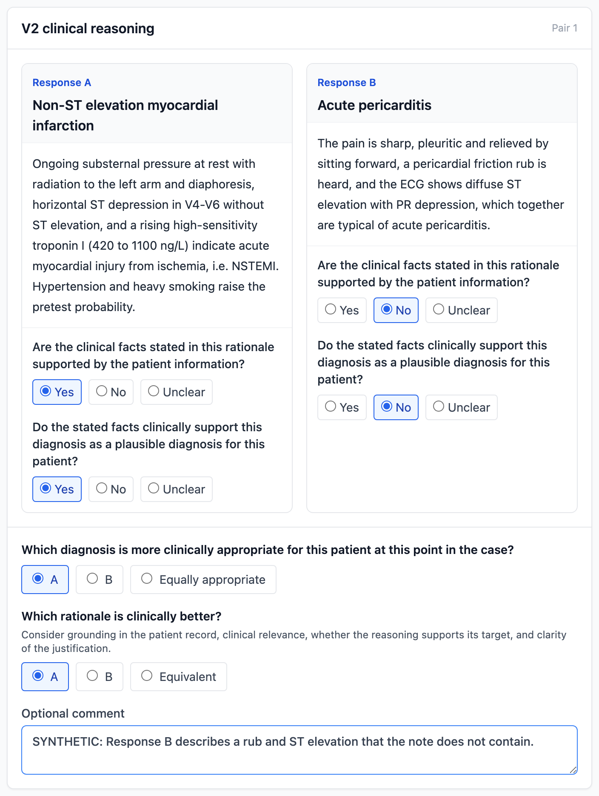
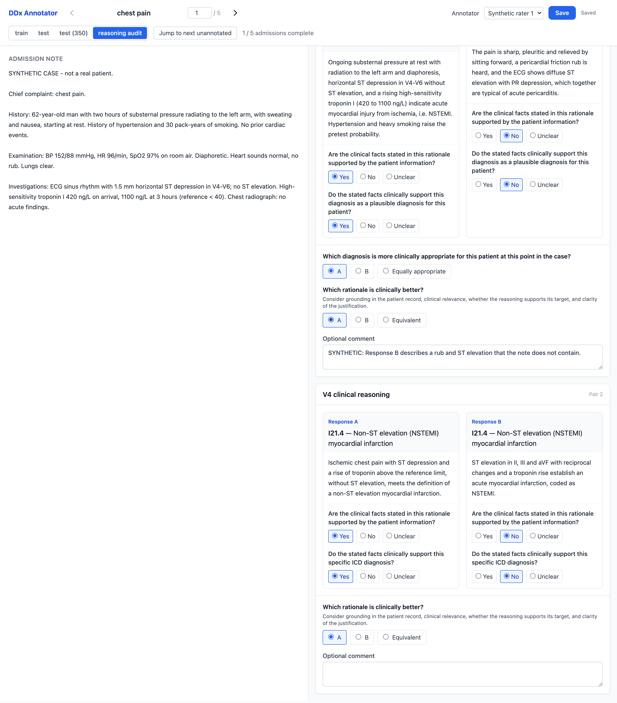

# Annotation walkthrough

How a clinician rated one admission in the MERLIN-DDx audit, shown on the synthetic demonstration cases. Every screenshot was captured from this repository's application running on [`examples/synthetic/`](../examples/synthetic/README.md) (`tests/e2e/screenshots.spec.ts`); the cases, rationales, annotator names and answers are synthetic.

**What is historical and what is not.** The audit screen is the study's component (`src/components/RebuttalAudit.tsx`) and backend, unchanged, so the screen, questions, answer options and enabling rules are exactly what clinicians used. Two things differ from the study:

- **Data:** the data are synthetic.
- **How the screen opens:** since v1.1.0 the screen is opened as in the study. Choose *reasoning audit* in the view selector of the general annotator application, which opens on the DDx annotation views ([docs/ddx_annotation/](ddx_annotation/README.md)). On a data root without DDx cases, the audit-only shell opens the screen directly. There, the *train / test / test (350)* buttons show a notice.

See [CHANGES_FROM_STUDY.md](../CHANGES_FROM_STUDY.md).

## 1. Clinical context

The clinician selects their name in the **Annotator** menu; without a selection no answer can be recorded. Each admission occupies one page:

- **left:** the admission note, the only clinical information shown;
- **right:** the V2 (diagnosis-stage) pair above the V4 (ICD-coding-stage) pair.

The header shows the chief complaint, the case position with previous/next and jump controls, *Jump to next unannotated*, and the number of completed admissions. No arm identity, verifier score or loop outcome appears anywhere.

## 2. V2: blinded comparison of diagnostic reasoning

Each pair shows two responses, labelled only **Response A** and **Response B**: a target diagnosis and the rationale for it. For each response the clinician answers, with Yes / No / Unclear:

- **Q1:** *Are the clinical facts stated in this rationale supported by the patient information?*
- **Q2 (V2):** *Do the stated facts clinically support this diagnosis as a plausible diagnosis for this patient?*

Here Response B states findings the note does not contain (a friction rub, ST elevation), so the synthetic rater answers No to Q1. Only after all four Q1/Q2 answers of the pair are given do the comparisons unlock:

- *Which diagnosis is more clinically appropriate for this patient at this point in the case?* (A / B / Equally appropriate), asked only when the two targets differ;
- *Which rationale is clinically better?* (A / B / Equivalent), always asked, with the hint to consider grounding, clinical relevance, support for the target and clarity;
- an optional free-text comment.

## 3. V4: assessment of ICD predictions

At the coding stage each target is an ICD-10-CM code followed by its official description. When a code does not exist in the FY2026 catalog (here `R42.0`), the closest valid parent category is shown with an explicit warning instead of a guessed description. Q2 reads *Do the stated facts clinically support this specific ICD diagnosis?* and the target question asks whether the code's level of specificity is justified, with the hint *Prefer a more specific code when the evidence supports it; penalize unsupported over-specificity.* The comparison questions stay disabled until all four judgments are given, as in the screenshot.

## 4. Completing an admission

Answers are saved automatically about a second after each change (and with **Save**) as one record per annotator and admission; the status next to the button changes from *Unsaved* to *Saved*. An admission counts as complete when, for both pairs, all four judgments and the rationale preference are given, and the target preference too if the targets differ. In this V4 pair both responses chose `I21.4`, so the target question is not shown and is stored as *not applicable*.

## What happens next

The saved records contain only positions (A/B). After both clinicians had completed every pair, the offline analysis checked completeness, joined the separate allocation key to map A/B to loop and zero-shot, and computed the statistics ([protocol](protocol.md), sections 6–7). To try that path, see the [quick start](../README.md#quick-start-synthetic-cases) and [reproducibility guide](reproducibility.md).
