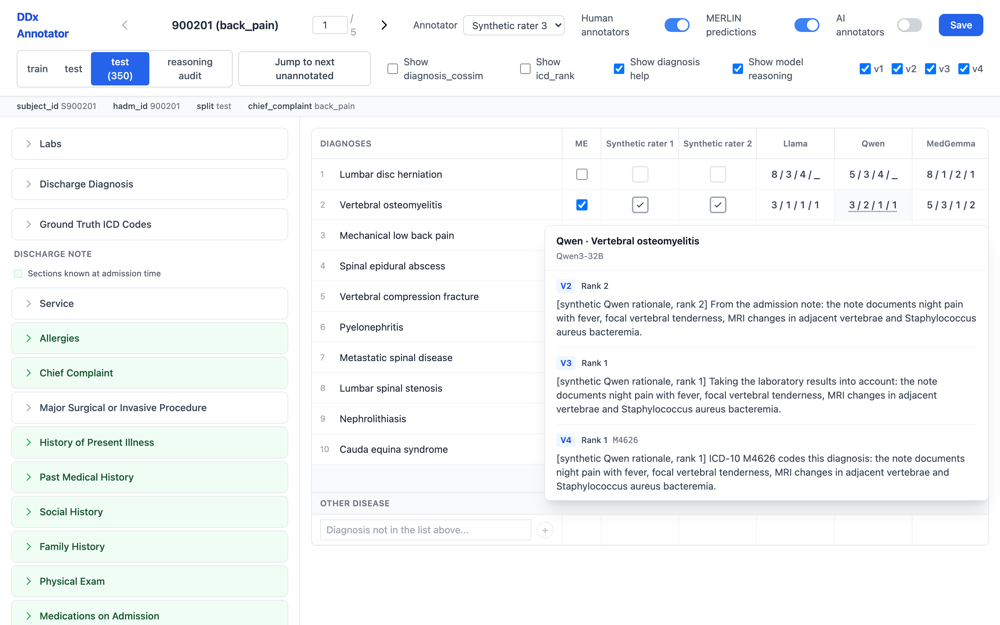
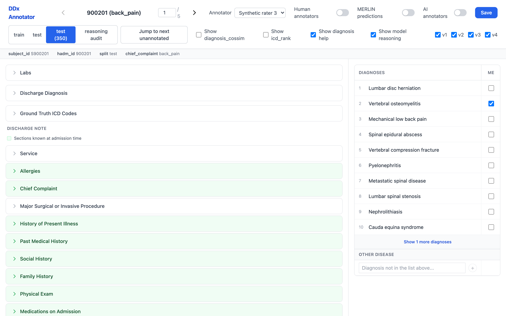
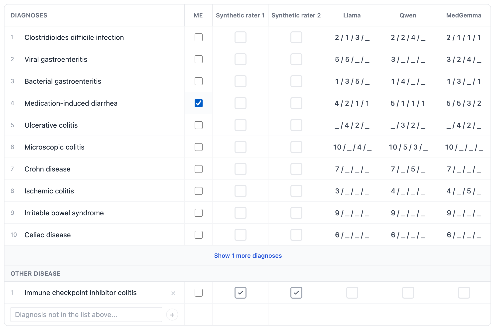
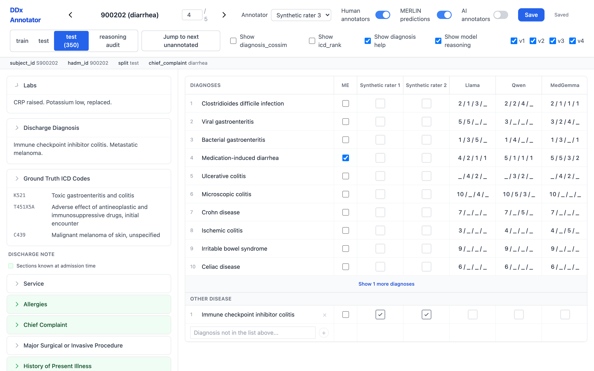

# DDx annotation walkthrough

The screenshots show the study interface (as released in v1.1.0, see [CHANGES_FROM_STUDY.md](../../CHANGES_FROM_STUDY.md); v1.2.0 adds views for new studies only) running on the synthetic cases in [examples/synthetic/ddx/](../../examples/synthetic/ddx/README.md). Every case, note, prediction and rating shown is synthetic. To reproduce them, run `uv run python scripts/run_demo.py --with-ratings` and open http://127.0.0.1:8765. To regenerate the images, run `CAPTURE_SCREENSHOTS=1 npx playwright test tests/e2e/screenshots.spec.ts`.

## 1. Choose the cohort, the annotator and the case

1. **View.** The view buttons select the cohort:
   - *train* and *test*: the two halves of the 70-case pilot;
   - *test (350)*: the 350-case study;
   - *reasoning audit*: the separate audit ([docs/reasoning_audit/](../reasoning_audit/README.md)).
2. **Annotator.** The *Annotator* menu selects whose record is edited. Without an annotator the interface is in evaluation mode and records nothing.
3. **Case.** The arrows, the position field and *Jump to next unannotated* move between cases. The current case is saved before moving.
4. **Clinical record (left).**
   - The discharge summary, section by section. Sections known at admission time are highlighted green.
   - Labs, the discharge diagnosis and the coder ICD codes in separate panels.
5. **Candidates (right).**
   - All WikiDoc candidates of the chief complaint in cosine order.
   - The clinician's own checkbox column *ME*.
   - Columns for the other clinicians and the three models.

## 2. Model ranks and reasoning

- **Rank labels.** A model cell such as `3 / 2 / 1 / 1` gives the candidate's rank at stages V1 / V2 / V3 / V4. An underscore means the candidate is not ranked at that stage.
- **Reasoning.** Hovering opens the model's reasoning for that candidate.
- **Stage filter.** The checkboxes *v1* to *v4* filter the stages shown.

## 3. Hiding model predictions and other clinicians' marks

Clinicians were instructed to annotate in this configuration ([protocol](protocol.md), section 4). Both the 70-case pilot (train and test splits) and the 350-case study were conducted blinded to MERLIN predictions and other clinicians' annotations:

- *Human annotators* off;
- *MERLIN predictions* off;
- *AI annotators* off (already off by default).

The Human annotators and MERLIN predictions switches start **on** at every page load, and the interface does not enforce the setting. Blinding was procedural rather than technically enforced; individual display states were not logged.

## 4. Adding a diagnosis that is not in the list

- **Adding.** Type the diagnosis in the *Other Disease* row and press +.
- **Sharing.** The added diagnosis belongs to the case: every clinician of that case sees it and can check it.
- **Deleting.** The × deletes it for everyone and removes it from all records of that case.

## 5. Reference panels and saving

- **Reference panels.** The discharge diagnosis and the coder ICD codes are available by design: the task is to confirm the reference diagnosis from the full record.
- **Saving.** *Save* stores the record on the server. Changes are also autosaved 30 seconds after the last edit.
- **Stored records.** The server keeps one JSON record per clinician and case under `annotations/<annotator>/<case>.json`. Added diagnoses go under `custom_diagnoses/<case>.json`.
